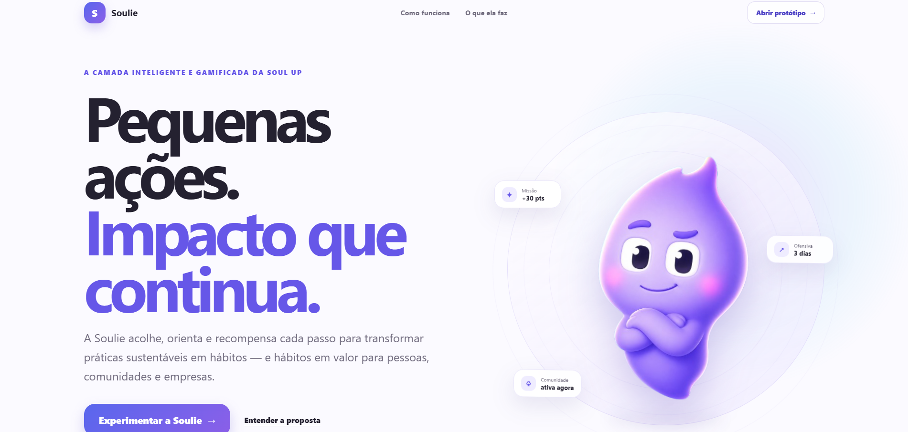
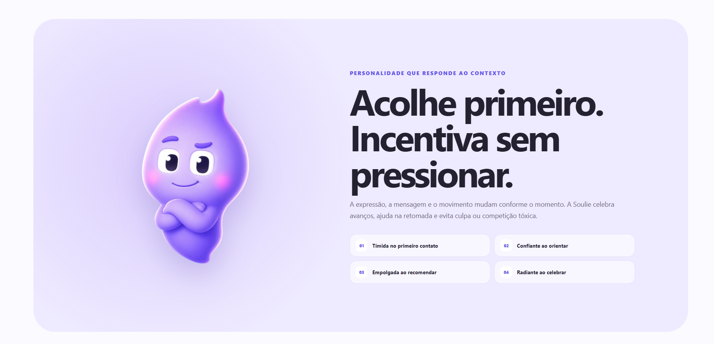
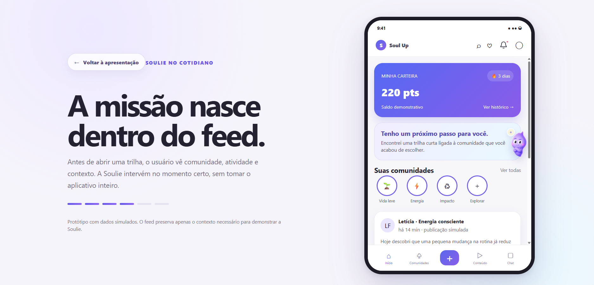

# Soulie — protótipo interativo

**Uma experiência responsiva que demonstra como a Soulie pode orientar pessoas, transformar ações sustentáveis em hábitos e fortalecer comunidades dentro da Soul Up.**

[Experimentar o protótipo](https://soulieprototipo.vercel.app/) · [Conhecer a apresentação original](https://soulie-omega.vercel.app/index.html) · [Explorar a documentação](docs/plans/DOCUMENTACAO_SOULIE.md)



---

## Sobre o projeto

A **Soul Up** é a plataforma de engajamento e sustentabilidade que fornece o contexto do produto. A **Soulie** é a camada gamificada e assistiva proposta para orientar essa experiência: ela acolhe a pessoa no primeiro acesso, entende interesses, recomenda comunidades e missões, acompanha o progresso e transforma pequenas conquistas em motivos para continuar.

Este repositório contém um **site-experiência**, não uma reconstrução completa da Soul Up. A interface do aplicativo serve como contexto visual para demonstrar como a Soulie se comportaria no produto real.

O protótipo foi pensado para dois usos complementares:

- apresentar a proposta da Soulie de forma clara para a empresa;
- permitir que a pessoa compreenda o conceito enquanto usa a experiência.

## Experimente

### [Abrir demonstração publicada →](https://soulieprototipo.vercel.app/)

A jornada funciona em desktop e mobile. Para conhecer o fluxo completo, comece pela apresentação e siga as etapas sugeridas pela Soulie.

```text
Apresentação
   ↓
Primeiro encontro
   ↓
Interesses e recomendações
   ↓
Comunidades e feed
   ↓
Trilhas de pequenas missões
   ↓
Conclusão, pontos e continuidade
```

## O que já está funcionando

- **Apresentação da proposta:** introdução curta, benefícios e acesso direto à experiência.
- **Onboarding leve:** seleção opcional de interesses para contextualizar recomendações.
- **Descoberta de comunidades:** sugestões explicadas, entrada, opção de deixar para depois e retorno para as comunidades escolhidas.
- **Feed demonstrativo:** carteira de pontos, ofensiva, publicações simuladas e missão recomendada.
- **Trilhas de missões:** objetivos maiores divididos em conquistas menores, preservando a recompensa total.
- **Conclusão gamificada:** atualização consistente de pontos, ofensiva e progresso.
- **Comunidade ativa:** desafio coletivo, contribuição demonstrativa e retorno visual do impacto.
- **Notificação inteligente:** configuração de preferências, exemplo de mensagem e motivo da recomendação.
- **Assistente contextual:** o avatar flutuante abre uma conversa guiada diferente no feed, no seletor e dentro da comunidade.
- **Continuidade da sessão:** o progresso é preservado no `sessionStorage` e pode ser reiniciado pela própria experiência.
- **Navegação responsiva:** as mesmas rotas e dados são utilizados em desktop e mobile.

## A assistente contextual

Ao tocar ou clicar no avatar, a Soulie abre um painel com uma recomendação baseada no estado atual da demonstração. A conversa utiliza respostas prontas para manter o protótipo previsível e não fingir a existência de uma IA real.

A assistente pode:

- sugerir a próxima trilha ou retomar uma missão iniciada;
- explicar por que uma recomendação apareceu;
- ajudar a escolher ou descobrir comunidades;
- revelar uma contribuição possível dentro de um desafio coletivo;
- reconhecer uma ação já concluída sem conceder pontos novamente.

O painel utiliza um diálogo com gerenciamento de foco, fecha por botão ou `Escape` e respeita a preferência por movimento reduzido.

## Interface do protótipo

As capturas abaixo mostram a identidade da Soulie e sua aplicação na experiência publicada.

### Uma personalidade que responde ao contexto



### A Soulie dentro da experiência da Soul Up



A interface combina:

- azul, roxo e gradientes próximos da identidade visual da Soul Up;
- cartões claros, cantos arredondados e hierarquia simples;
- Soulie pequena e integrada ao contexto, sem ocupar toda a experiência;
- animações discretas e feedback imediato;
- composições específicas para desktop e mobile sem duplicar páginas.

## Tecnologias

| Camada | Tecnologia |
|---|---|
| Interface | React 19 + TypeScript 6 |
| Build e desenvolvimento | Vite 8 |
| Rotas | React Router 8 em modo declarativo |
| Estado | Context API + `useReducer` |
| Persistência | `sessionStorage` abstraído por serviço |
| Estilos | CSS Modules + tokens CSS globais |
| Dados | Arquivos TypeScript locais e tipados |
| Publicação | Vercel |

A demonstração não usa biblioteca externa de estado, framework CSS, backend nem SDK de IA.

## Arquitetura

```text
src/
├─ app/                  # inicialização, rotas e provider
├─ assets/soulie/        # imagens utilizadas pela experiência
├─ components/           # estruturas compartilhadas do protótipo
├─ data/                 # comunidades, missões e conteúdos simulados
├─ features/soulie/      # painel, regras e motor contextual da Soulie
├─ hooks/                # acesso seguro ao estado da demonstração
├─ pages/                # páginas ligadas às rotas
├─ services/             # persistência da sessão
├─ state/                # tipos, estado inicial e reducer
└─ styles/               # reset, estilos globais e tokens
```

Princípios aplicados:

- a lógica da Soulie permanece separada do contexto visual da Soul Up;
- o reducer centraliza as alterações de pontos, progresso e ofensiva para mantê-las coerentes;
- recomendações são determinísticas e derivadas do estado local;
- desktop e mobile compartilham componentes, rotas e conteúdo;
- nenhuma tela depende de um serviço externo para funcionar.

## Executar localmente

### Pré-requisitos

- Node.js;
- npm.

### Instalação

```bash
git clone https://github.com/EnzoNukui/mvp_soulup.git
cd mvp_soulup
npm install
npm run dev
```

O terminal mostrará o endereço local disponibilizado pelo Vite.

### Comandos disponíveis

| Comando | Finalidade |
|---|---|
| `npm run dev` | inicia o servidor de desenvolvimento |
| `npm run typecheck` | verifica os tipos TypeScript |
| `npm run lint` | executa a análise estática |
| `npm run build` | gera a versão de produção |
| `npm run preview` | abre uma prévia local do build |

## O que é funcional e o que é simulado

### Funcional no protótipo

- navegação entre as etapas;
- seleção de interesses e comunidades;
- início e conclusão de missões;
- atualização de pontos, ofensiva e progresso;
- assistente contextual e suas ações guiadas;
- preferências de notificação;
- persistência e reinício da demonstração;
- comportamento responsivo e navegação por teclado.

### Simulado

- inteligência artificial e aprendizado de comportamento;
- autenticação e perfis reais;
- envio externo de notificações;
- validação ambiental das ações;
- feed social e chat entre usuários;
- integrações com a Soul Up, empresas de energia, PIX ou pagamentos;
- cálculo científico de impacto ambiental;
- métricas empresariais reais.

Os dados simulados são identificados na interface para evitar que a demonstração seja confundida com uma integração em produção.

## Documentação

- [Visão completa da Soulie](docs/plans/DOCUMENTACAO_SOULIE.md)
- [Plano do site-protótipo](docs/plans/PLANO_PROTOTIPO_SITE.md)
- [Arquitetura React](docs/plans/ARQUITETURA_REACT.md)
- [Pesquisa de UX](docs/pesquisa/PESQUISA_DIRETORIOS_UX.md)
- [Interação com o avatar](docs/plans/PLANO_INTERACAO_AVATAR_SOULIE.md)
- [Notificação inteligente](docs/plans/PLANO_NOTIFICACAO_INTELIGENTE.md)
- [Referências visuais](docs/referencias/)

## Estado atual

O projeto está em fase de **protótipo funcional demonstrável**. A jornada principal está navegável e publicada, enquanto integrações reais, testes automatizados e recursos administrativos permanecem fora do escopo desta entrega.

---

**Soulie** — pequenas ações, progresso visível e comunidades em movimento.
